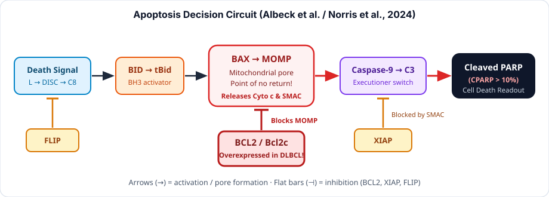
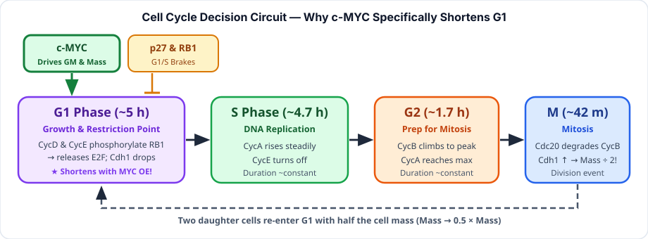

# 3.1 Apoptosis, Cell Cycle & Double-Hit Lymphoma

**Modelling Cell Fate — Computational Modelling SSC (Week 5)**
*Mitchell Lab, Brighton and Sussex Medical School*

Click **📽️ Present Slides** above to step through this lecture slide-by-slide in class, or scroll down to read at your own pace before running the live simulations.

---

## Overview: From Signalling to Cell Fate

- **Last week (NF-κB Signalling):** We saw how mutations in B-cell lymphoma (CLL, Waldenström Macroglobulinemia, DLBCL) drive hyperactive NF-κB signalling—and screened drugs to calm the pathway down.
- **Today (Cell Fate Decisions):** How do signalling changes actually decide whether a B-cell **dies** or **divides**?
  - **Part A — Apoptosis:** Modelling programmed cell death and how **BCL2** overexpression delays or prevents death (**Figure 1B**).
  - **Part B — Cell Cycle:** Modelling G1 → S → G2 → M progression and how **c-MYC** overexpression speeds up division—specifically by shortening **G1** (**Figure 1E**).
  - **Your Exercises:** Can over-expressing or knocking down another gene **rescue** BCL2 resistance or c-MYC-driven hyper-proliferation?

---

## Clinical Motivation: Double-Hit Lymphoma & Norris et al. (2024)

In **Diffuse Large B-Cell Lymphoma (DLBCL)**, standard immunochemotherapy (R-CHOP) cures ~60% of patients—but the remaining ~40% relapse or fail treatment.

In *Norris, Jones, Mancini, Chevassut, Simoes, Pepper, Pepper & Mitchell* (**Blood Cancer Journal**, 2024, `14:105`, [doi:10.1038/s41408-024-01090-y](https://www.nature.com/articles/s41408-024-01090-y)), our group integrated patient sequencing profiles into personalised computational models of **apoptosis** and the **cell cycle**:

- Patients carrying **both** an **anti-apoptotic (AA)** signature (such as **BCL2** overexpression) **and** a **pro-proliferative (PP)** signature (such as **c-MYC** overexpression)—known clinically as **"Double-Hit"** or **AAPP** lymphoma—had **dramatically worse survival**:
  - **7.8 months** median overall survival in poor-prognosis AAPP clusters
  - versus **90% overall survival at 10 years** in patients lacking both signatures!
- Today we recreate **Figure 1B** and **Figure 1E** from Norris et al. (2024) live in Julia!

---

## Part A: How the Apoptosis Model Works

Apoptosis is an **all-or-nothing, irreversible switch**—a cell shouldn't "half-die"! Our 59-species ODE model (built on *Albeck et al., PLoS Biology, 2008*) captures the molecular cascade from death-receptor signalling down to DNA/protein cleavage:

1. **Initiation:** A death signal (`L` → `DISC` → active **Caspase-8**, opposed by **FLIP**) cleaves **BID** into `tBid`.
2. **Mitochondrial Checkpoint (MOMP):** `tBid` activates **BAX** to form pores in the mitochondrial outer membrane (**MOMP** — the *point of no return*).
3. **The BCL2 Brake:** Anti-apoptotic **BCL2** (and cytosolic `Bcl2c`) binds and neutralises `tBid` and `BAX`, raising the threshold required to trigger MOMP.
4. **Execution:** Once MOMP occurs, mitochondria release **Cytochrome c** and **SMAC** (which blocks **XIAP**), triggering an explosive activation of **Caspase-3** that cleaves **PARP** into **Cleaved PARP (`CPARP`)**—our quantitative readout of **time to cell death** (`CPARP > 10%`)!

---

## Part B: How the Cell Cycle Model Works

For a B-cell to divide into two daughter cells, it must progress in strict order through four phases—**G1 → S → G2 → M**—controlled by oscillating **Cyclins**, **CDKs**, and **tumour suppressor brakes** (*37-species ODE model with division event callbacks*):

1. **G1 Phase (Growth & Commitment):** **c-MYC** drives ribosome/growth machinery (`GM`) and cell `Mass`. **Cyclin D** and **Cyclin E** phosphorylate **RB1**, releasing **E2F** (opposed by the CDK inhibitor **p27 / `CDKN1B`**). Once **Cdh1** drops below 50%, the cell commits to **G1 → S**!
2. **S Phase (DNA Replication):** **Cyclin A** rises steadily while **Cyclin E** turns off.
3. **G2 Phase (Preparation):** **Cyclin B** climbs to its peak as the cell prepares to enter mitosis.
4. **M Phase (Mitosis & Division):** Active **Cdc20** triggers Cyclin B degradation and **Cdh1** reactivation—triggering a **division event** where `Mass` and `GM` halve (`0.5×`) and two daughter cells start a fresh **G1**!

---

## Ready for Today's Practicals!

1. **First half — Apoptosis & BCL2:** Open [**3.2 Apoptosis Modelling: BCL2 Delays Cell Death (Figure 1B)**](02-apoptosis-bcl2-model.ipynb) to recreate Figure 1B and test which gene over- or under-expressions can **rescue BCL2-mediated resistance to cell death**.
2. **Second half — Cell Cycle & c-MYC:** Open [**3.3 Cell Cycle Modelling: c-MYC Shortens G1 (Figure 1E)**](03-cell-cycle-myc-model.ipynb) to recreate Figure 1E, confirm that **G1** is the specific phase shortened by c-MYC, and test which gene targets can **rescue MYC-driven hyper-proliferation**.
