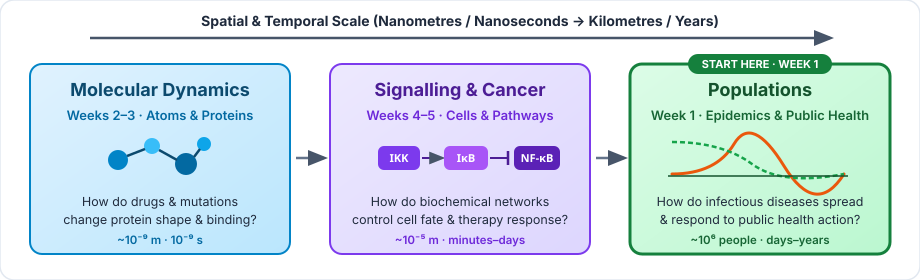

# Modelling Across Scales: From Molecules to Pandemics

Welcome to the **Brighton and Sussex Medical School (BSMS) Student Selected Component (SSC)** taught by the [Mitchell Lab](https://mitchell.science/).

This interactive book combines our **in-class lecture slides** and **live Julia computational simulations** in one place—no logins, software installation, or prior coding or mathematics background required.

:::{tip} Two Ways to Use This Book
- **📖 Reading Mode (default):** Scroll through the explanations, diagrams, equations, and pre-computed plots at your own pace, and click **⚡ Activate Live Editable Julia Cells** whenever you want to edit parameters and run simulations in your browser.
- **📽️ Present Slides:** Click **📽️ Present Slides** (top toolbar or top-right header) to step section-by-section in full-screen slide view—ideal for presenting in class while running live Julia simulations right on the projector. Press `Esc` or click **📖 Reading Mode** at any time to return.
:::

---

## SSC Structure (8 Weeks)

Across this SSC, we explore how computational simulations help us understand biology and medicine across three very different scales—from individual protein atoms up to entire human populations:

| Week | Topic | Scale | Status |
| :--- | :--- | :--- | :--- |
| **Week 1** | **Intro to Computational Modelling & Population-Scale Models (SI, SIS, SIR, SIRS, SEIR)** | Populations & Public Health | **Live in this book** |
| **Week 2** | Molecular Dynamics Modelling 1 | Atoms & Proteins | *Slides on [mitchell.science/post/teaching](https://mitchell.science/post/teaching/)* |
| **Week 3** | Molecular Dynamics Modelling 2 | Atoms & Proteins | *Slides on [mitchell.science/post/teaching](https://mitchell.science/post/teaching/)* |
| **Week 4** | Cancer Signalling 1 | Cells & Biochemical Networks | *Also see [Interactive ODE Tutorials](https://mitchell.science/tutorials/)* |
| **Week 5** | Cancer Signalling 2 | Cells & Biochemical Networks | *Also see [Interactive ODE Tutorials](https://mitchell.science/tutorials/)* |
| **Week 6** | Preparation for Assessment (no taught session) | — | Independent project work |
| **Week 7** | Assessment Week 1 (6-minute presentations — all attend) | — | Presentation |
| **Week 8** | Assessment Week 2 (6-minute presentations — all attend) | — | Presentation |

---

## Start Week 1

Begin with [**1.1 Introduction to Computational Modelling**](week-1/01-intro-to-modelling.md), or jump straight into the live epidemic simulations:

- [**1.2 The SI & SIS Model**](week-1/02-si-sis-model.ipynb) — Your first two-compartment outbreak model
- [**1.3 The SIR & SIRS Model**](week-1/03-sir-sirs-model.ipynb) — Adding immunity and waning immunity
- [**1.4 Endemic SIR: Births & Deaths**](week-1/04-endemic-sir-model.ipynb) — Population turnover and recurrent waves
- [**1.5 The SEIR Model & Wrap-Up**](week-1/05-seir-model.ipynb) — Incubation periods, disease-induced mortality, and discussion
