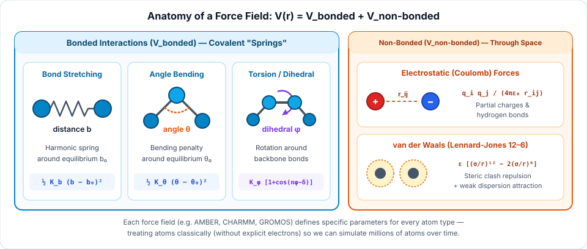
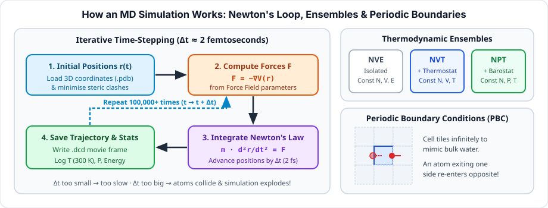
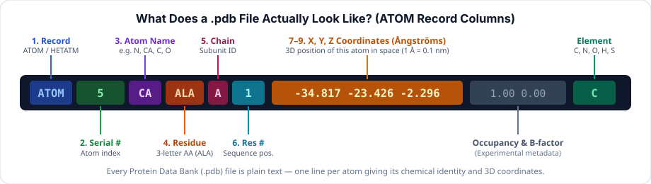

# 2.1 Molecular Dynamics I: Force Fields, Equations & PDB Files

**Modelling Across Scales: From Molecules to Pandemics (Week 2)**
*Dr Eleanor Jayawant — Mitchell Lab, Brighton and Sussex Medical School*

Click **📽️ Present Slides** above to step through this lecture slide-by-slide in class, or scroll down to read at your own pace before exploring real protein structures in Python.

---

## Overview: Zooming In to the Atomic Scale

- **Last week (Week 1 — Populations):** We modelled how infectious diseases spread across entire human populations using differential equations (SI, SIS, SIR, SEIR).
- **This week & next week (Weeks 2–3 — Molecules):** We zoom all the way down to the **smallest of our three biological scales** — individual **atoms and proteins** — and learn how **Molecular Dynamics (MD)** acts as a **"computational microscope"**.
- **Today's session (~50 mins):**
  1. **Lecture (~20–25 mins):** Protein structure, force fields, Newton's equations of motion, ensembles, and periodic boundary conditions.
  2. **Activity (~15 mins):** Exploring real Protein Data Bank (`.pdb`) files from [RCSB PDB](https://www.rcsb.org/) and inspecting 3D protein coordinates live in Python.
  3. **Class Discussion (~10 mins):** Compare structures, experimental methods, and biological insights.

---

## Why Model Molecules?

Inside every living cell, proteins are not static museum statues — they constantly **wiggle, fold, flex, bind ligands, and open or close channels** on nanosecond to millisecond timescales!

- Understanding how proteins **move and interact** is essential for **drug discovery**, understanding genetic mutations (such as **CFTR** in cystic fibrosis or **MYD88** in lymphoma), and designing better medicines.
- Watch an all-atom MD simulation of a crowded bacterial cytoplasm *(RIKEN & Michigan State University)*:
  [All-atom Molecular Dynamics Simulation of the Bacterial Cytoplasm (YouTube)](https://youtu.be/5JcFgj2gHx8?t=207)

:::{admonition} A "Computational Microscope"
:class: note
Experimental techniques like **X-ray crystallography**, **NMR spectroscopy**, and **cryo-electron microscopy (cryo-EM)** give us atomic-resolution snapshots of proteins — each with its own strengths and limitations. **Molecular dynamics** fills in the motion between snapshots, letting us watch how every single atom moves over time!
:::

---

## Protein Structure & Non-Covalent Interactions

Proteins are **polypeptides** — chains built from sequences of **20 standard amino acids** (each unit is called a **residue**). To carry out their biological function (as enzymes, antibodies, receptors, channels, or structural scaffolds), proteins fold into specific 3D shapes driven by **non-covalent interactions**:

- **Hydrogen bonding** (backbone and sidechain H-bonds that stabilise helices and sheets)
- **Ionic (electrostatic) interactions** (attractions and repulsions between charged sidechains)
- **van der Waals forces** (steric packing and weak short-range dispersion attractions)
- **Hydrophobic packing** (oily non-polar sidechains tucking away from surrounding water)

### Four Levels of Protein Structure

| Level | Description | Example |
| :--- | :--- | :--- |
| **Primary** | Linear amino acid sequence along the polypeptide chain | `Ala–Ala–Ala–…` |
| **Secondary** | Regular local backbone motifs stabilised by H-bonds | **$\alpha$-helices** and **$\beta$-sheets** |
| **Tertiary** | Overall 3D folded shape of a single polypeptide chain | Globular Villin or Lysozyme |
| **Quaternary** | Multiple polypeptide chains (subunits) assembling together | Haemoglobin, NF-$\kappa$B heterodimer |

---

## Biological Systems Are Big! (QM vs Molecular Mechanics)

Why don't we just solve quantum mechanics (Schrödinger's equation) for an entire protein?

- **Quantum Mechanics (QM):** Models every electron explicitly — extraordinarily accurate, but so computationally expensive that we can only simulate **tens of atoms** for picoseconds!
- **Biologically relevant systems are huge:** A single protein surrounded by water contains **tens of thousands to millions of atoms** (and macroscopic samples are on the scale of $10^{23}$ atoms).
- **Molecular Mechanics (Force Field Theory):** Strips away explicit electronic motion and treats atoms as classical spheres connected by springs and interacting through space.
  - Although quantum bond-breaking effects are approximated away, **classical force fields** give an accurate, fast approximation that lets us simulate whole proteins, membranes, and drugs!

---

## Anatomy of a Force Field

A **force field** is the mathematical potential energy function $V(\mathbf{r})$ — plus its atom-specific parameters — that relates the 3D positions of all atoms to the total potential energy of the system:

$$V(\mathbf{r}) = V_{\text{bonded}} + V_{\text{non-bonded}}$$

### 1. Bonded Interactions ($V_{\text{bonded}}$)

$$V_{\text{bonded}} = \sum_{\text{bonds}} \tfrac{1}{2} K_b (b - b_0)^2 + \sum_{\text{angles}} \tfrac{1}{2} K_\theta (\theta - \theta_0)^2 + \sum_{\text{dihedrals}} K_\phi \bigl[1 + \cos(n\phi - \delta)\bigr] + \sum_{\text{impropers}} K_\psi (\psi - \psi_0)^2$$

- **Bond stretching ($b$)** & **Angle bending ($\theta$):** Harmonic springs penalising distortion away from equilibrium bond lengths ($b_0$) and angles ($\theta_0$).
- **Torsion / Dihedral angles ($\phi$):** Periodic energy barriers controlling rotation around covalent bonds — crucial for protein folding!

### 2. Non-Bonded Interactions ($V_{\text{non-bonded}}$)

$$V_{\text{non-bonded}} = \sum_{i < j} \left( \frac{q_i q_j}{4\pi\varepsilon_0 \varepsilon r_{ij}} + \varepsilon_{ij}\left[\left(\frac{\sigma_{ij}}{r_{ij}}\right)^{12} - 2\left(\frac{\sigma_{ij}}{r_{ij}}\right)^6\right] \right)$$

- **Electrostatics (Coulomb):** Attraction and repulsion between partial atomic charges $q_i, q_j$ (drives salt bridges and hydrogen bonds).
- **van der Waals (Lennard-Jones 12–6):** Strong short-range steric repulsion ($r^{-12}$, stopping atoms from overlapping) balanced by weak dispersion attraction ($-r^{-6}$).

---

## How Do MD Simulations Work?

Molecular dynamics brings a force field to life using **Newton's Equations of Motion**:

$$m_i \frac{d^2 \mathbf{r}_i(t)}{dt^2} = \mathbf{F}_i = -\nabla_i V(\mathbf{r})$$

1. **First Law:** An atom moves at constant velocity unless a net force acts on it.
2. **Second Law:** Force equals mass times acceleration ($\mathbf{F} = m\mathbf{a}$), where the force on each atom is the negative gradient of the force-field energy $V(\mathbf{r})$.
3. **Third Law:** Every pairwise force has an equal and opposite reaction.

### Choosing the Time Step ($\Delta t$)

- We solve Newton's second law **iteratively** in tiny discrete steps — typically **$\Delta t = 2\text{ fs}$ ($0.002\text{ ps}$)**!
- **Too small $\Delta t$:** Computationally expensive — simulating even 1 nanosecond takes forever.
- **Too large $\Delta t$:** Atoms overshoot, collide into each other, forces spike to infinity, and the whole simulation **explodes**!
- At regular intervals we record coordinates into a **trajectory file** (`.dcd`) and log physical observables (**Temperature**, **Pressure**, **Potential Energy**).

---

## Ensembles & Periodic Boundary Conditions

### Thermodynamic Ensembles (Matching Lab Conditions)

- **NVE (Microcanonical):** Constant particles ($N$), volume ($V$), and total energy ($E$) — an isolated system. Rarely matches real wet-lab experiments!
- **NVT (Canonical):** Constant $N$, $V$, and **Temperature ($T$)** maintained by a **thermostat** (e.g., the **Langevin integrator** we will use next week at $T = 300\text{ K}$).
- **NPT (Isothermal-Isobaric):** Constant $N$, **Pressure ($P = 1\text{ bar}$)**, and **Temperature ($T$)** maintained by both a **thermostat** and a **barostat** — closest to physiological conditions.

### Periodic Boundary Conditions (PBCs)

- Simulating a realistic bulk volume of water directly would require far too many atoms.
- With **Periodic Boundary Conditions**, our simulation box is **tiled infinitely in all 3D directions**:
  - Whenever a particle exits one face of the box, an identical periodic image enters from the opposite face.
  - This eliminates artificial vacuum edges while keeping the atom count manageable — provided the box is large enough that a protein never interacts with its own periodic image!

---

## What Does a `.pdb` File Actually Look Like?

Almost every MD simulation starts from an experimentally determined **Protein Data Bank (`.pdb`)** file — for example, **CFTR bound to the cystic fibrosis drug ivacaftor** (`6o2p`).

Under the hood, a `.pdb` file is just **plain text** containing one `ATOM` line per atom:

- **Column 1:** Record type (`ATOM` for protein/nucleic acid, `HETATM` for drugs, ions, or water)
- **Column 2:** Atom serial number
- **Column 3:** Atom name (`N`, `CA`, `C`, `O`, sidechain atoms)
- **Column 4:** 3-letter residue name (`ALA`, `GLY`, `VAL`, …)
- **Column 5:** Chain identifier (`A`, `B`, …)
- **Column 6:** Residue sequence number
- **Columns 7–9:** 3D orthogonal **$X, Y, Z$ coordinates** (in Ångströms, $1\text{ Å} = 0.1\text{ nm}$)
- **Final column:** Chemical element symbol (`C`, `N`, `O`, `H`, `S`, …)

---

## Week 2 Activity: Exploring Protein Structures

Now it's your turn to inspect real experimental protein structures!

### Part A — Browse the RCSB Protein Data Bank (10 mins)

1. Open the **[RCSB Protein Data Bank](https://www.rcsb.org/)** in a new tab.
2. Pick one of the medically relevant structures below (or search for your favourite protein!):

| Protein | PDB ID | Clinical / Biological Relevance |
| :--- | :--- | :--- |
| **CFTR + Ivacaftor** | [`6o2p`](https://www.rcsb.org/structure/6o2p) | Chloride channel mutated in cystic fibrosis, bound to targeted potentiator drug |
| **Amyloid-$\beta$ fibril** | [`6w0o`](https://www.rcsb.org/structure/6w0o) | Misfolded $\beta$-sheet plaques implicated in Alzheimer's disease |
| **BRCA1 BRCT domain** | [`4ifi`](https://www.rcsb.org/structure/4ifi) | DNA-repair tumour suppressor mutated in hereditary breast & ovarian cancer |
| **Huntingtin (HTT)** | [`6ez8`](https://www.rcsb.org/structure/6ez8) | Neurodegenerative protein mutated in Huntington's disease |
| **Cyclophilin A** | [`2rma`](https://www.rcsb.org/structure/2rma) | Target of the immunosuppressant drug cyclosporin A |
| **NF-$\kappa$B heterodimer** | [`1le5`](https://www.rcsb.org/structure/1le5) | Key blood-cancer transcription factor we will model in **Week 4**! |

3. Open **3D View: Structure** to rotate, zoom, and switch visual representations, then download/display the **PDB Format** text file and note:
   - Experimental **technique** used to resolve it (X-ray crystallography, Cryo-EM, NMR)
   - Number of **protein chains** and **residues per chain**
   - Total number of **atoms** in the file
   - **Anything else** present (small-molecule drug/ligand, DNA, ions, water molecules)

### Part B — Interactive Python PDB Explorer

Ready to see how Python parses `.pdb` coordinates, visualises proteins in 3D, and even **builds a custom 3D peptide spelling your own name**?

Continue to [**2.2 Guided Activity: Exploring PDB Structures in Python**](02-exploring-pdb-structures.ipynb)!
