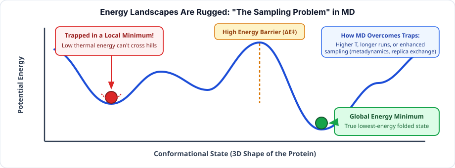
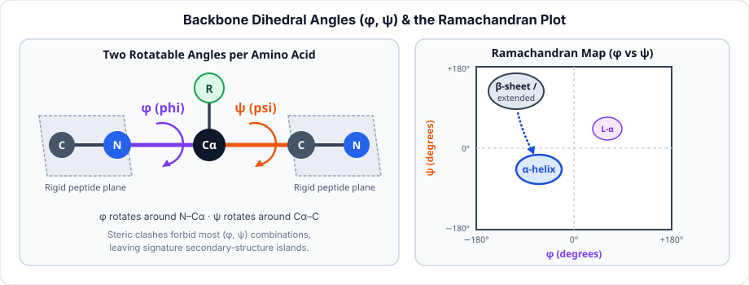

# 3.1 Molecular Dynamics II: Energy Landscapes & Trajectory Analysis

**Modelling Across Scales: From Molecules to Pandemics (Week 3)**
*Dr Eleanor Jayawant — Mitchell Lab, Brighton and Sussex Medical School*

Click **Present Slides** above to step through this lecture slide-by-slide in class (~10 mins), then dive straight into [**3.2 Live OpenMM Practical: Protein Folding & Trajectory Analysis**](04-protein-folding-simulation.ipynb) (~35 mins + 10 mins discussion).

---

## Previously on Modelling Across Scales…

In **Week 2 (Molecular Dynamics I)** we saw that:

- **Molecular dynamics (MD)** reveals how biomolecules move, flex, and interact — crucial for understanding protein function and **drug discovery**.
- MD iteratively solves **Newton's equations of motion** ($m\,\ddot{\mathbf{r}} = -\nabla V$) using a set of bonded and non-bonded interaction potentials called a **force field**.
- Running an MD simulation outputs a **trajectory** (`.dcd`) of atomic positions over time that can be watched as a 3D movie.
- Most MD simulations start from an experimental or built **`.pdb` coordinate file** — like the structures we explored last week.

---

## Energy Landscapes Are Complicated!

Even a small molecule like **glucose** can adopt multiple 3D shapes (*chair* vs *boat* conformations), separated by an **energy barrier** that must be crossed to interconvert.

For a macromolecule with hundreds or thousands of rotatable bonds — like a **protein** — the potential energy surface is a vast, rugged landscape with **many hills (barriers) and valleys (local minima)**:

### "The Sampling Problem"

- If thermal energy ($k_B T$) or simulation time is too limited, our simulated protein can become **trapped in a local energy minimum** — never crossing the barrier to reach its true lowest-energy **global minimum**!
- Even rotating a single peptide bond (*cis* ↔ *trans*) can carry a high energy barrier.
- **Enhanced sampling techniques** (such as **replica exchange**, **metadynamics**, **umbrella sampling**, and **steered MD**) add clever physical "tricks" to help simulations cross barriers and explore conformational space much faster *(Lazim, Suh & Choi, Int. J. Mol. Sci., 2020)*.

---

## What Can We Measure From an MD Trajectory?

A raw MD movie looks great — but quantitative **trajectory analysis** turns coordinates into rigorous biochemistry and biophysics:

- **Secondary structure estimation** (e.g., $\alpha$-helix vs $\beta$-sheet vs random coil via **DSSP**)
- **Hydrogen bonding** networks over time
- **Backbone angles & dihedrals** ($\phi$ and $\psi$ → **Ramachandran plots**)
- **Root Mean Squared Deviation (RMSD)** — how much the 3D structure changes over time
- **End-to-end & inter-atomic distances** (e.g., tracking collapse or domain opening)
- **Radius of gyration ($R_g$)** & **Solvent Accessible Surface Area (SASA)**
- **Potential energy** & predicted experimental observables (e.g., NMR chemical shifts)

---

## Analysis Spotlight 1: Secondary Structure & Hydrogen Bonding

### Secondary Structure (DSSP)
- Secondary structure motifs underpin protein stability and function — for example, transmembrane **$\alpha$-helices** span cell membranes to initiate cell signalling, while misfolded **$\beta$-sheets** form toxic amyloid fibrils.
- Algorithms like **DSSP** (*Define Secondary Structure of Proteins*) classify every amino acid at every frame so we can track folding or unfolding across time.

### Hydrogen Bonding
- A **hydrogen bond** is a directional dipole–dipole attraction between a hydrogen covalently bound to an electronegative **donor** ($\text{N–H}$, $\text{O–H}$) and a nearby electronegative **acceptor** ($\text{O}$, $\text{N}$).
- Backbone $\text{C=O}\cdots\text{H–N}$ hydrogen bonds lock $\alpha$-helices ($i \to i+4$) and $\beta$-sheets into place, and sidechain H-bonds stabilise protein–protein and protein–drug complexes *(Jayawant et al., Phys. Chem. Chem. Phys., 2020)*.

---

## Analysis Spotlight 2: Backbone Dihedrals & the Ramachandran Plot

Every amino acid along a protein backbone has two main rotatable torsion angles:

- **$\phi$ (phi):** rotation around the $\text{N–C}_\alpha$ bond
- **$\psi$ (psi):** rotation around the $\text{C}_\alpha\text{–C}$ bond

Because atoms cannot overlap sterically, only specific combinations of $(\phi, \psi)$ are physically allowed — and each secondary structure occupies its own **fingerprint island** on a **Ramachandran plot**:

- **Top-left ($\phi \approx -120^\circ,\ \psi \approx +130^\circ$):** Extended chains & **$\beta$-sheets**
- **Bottom-left ($\phi \approx -60^\circ,\ \psi \approx -45^\circ$):** Right-handed **$\alpha$-helices**
- **Top-right ($\phi \approx +60^\circ,\ \psi \approx +45^\circ$):** Left-handed $\alpha$-helices (rare — mostly **Glycine**, which has no bulky sidechain!)

In today's practical, you will watch an extended **polyalanine** peptide migrate straight from the **$\beta$/extended region** into the **$\alpha$-helix region** on your own Ramachandran plot!

---

## Analysis Spotlight 3: RMSD (Equilibrium & Flexibility)

**Root Mean Squared Deviation (RMSD)** measures the average 3D distance (in Å or nm) between two superposed structures — usually each trajectory frame compared back to the starting (or reference) structure:

$$\text{RMSD}(t) = \sqrt{\frac{1}{N}\sum_{i=1}^{N} \bigl\|\mathbf{r}_i(t) - \mathbf{r}_i^{\text{ref}}\bigr\|^2}$$

- **Small RMSD:** The two structures are spatially very similar.
- **Plateauing RMSD:** Indicates the simulation has reached **equilibrium** (no longer undergoing major structural drift).
- **Per-residue fluctuations:** Rigid $\alpha$-helices and $\beta$-cores stay low, while flexible loops and terminal tails fluctuate widely *(Arnittali et al., Procedia Computer Science, 2019)*.

---

## Today's Practical & Assessment Ideas

### Guided Practical (~35 mins)
Open [**3.2 Live OpenMM Practical: Simulating Protein Folding**](04-protein-folding-simulation.ipynb) and click **Activate Live Editable Python Cells** to:

1. Inspect and view **Villin** (`villin_water.pdb`) and fully extended **polyalanine** (`polyALA.pdb`) in 3D.
2. Run a **200 ps** all-atom MD simulation of `polyALA.pdb` folding into an **$\alpha$-helix** at $300\text{ K}$ using **OpenMM** (`amber10.xml` + Langevin thermostat).
3. Watch your freshly simulated **3D folding movie** with play/pause and frame scrubbing.
4. Quantify folding with **end-to-end distance** and a **Ramachandran plot** (first 30 vs last 30 frames).

### Questions for Class Discussion (Last 10 mins)
- What happens to the **end-to-end distance** as polyalanine folds?
- Which **secondary structure** emerges in the Ramachandran plot?
- What do you predict happens if you **raise or lower the temperature** (e.g. $100\text{ K}$ vs $300\text{ K}$ vs $600\text{ K}$)?

:::{admonition} Ideas for Your SSC Assessment Project
:class: tip
Run the baseline polyalanine simulation — and then systematically **change one variable** and explain the biophysical and medical significance:
- **Switch the sequence:** Compare `polyALA.pdb` (strong helix former) vs `polyGLY.pdb` (tiny sidechain, hyper-flexible) vs `polyGV.pdb` (Gly–Val repeat) vs a **custom peptide spelling a sequence or your own name**!
- **Change temperature:** Compare folding & flexibility at low ($100\text{ K}$), physiological ($300\text{ K}$–$310\text{ K}$), and denaturing ($500\text{ K}$–$700\text{ K}$) temperatures.
- **Change simulation length or time step ($\Delta t$):** See how sampling improves over longer timescales — or what happens if $\Delta t$ is made too large!
:::
