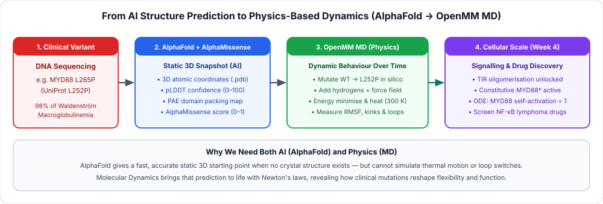
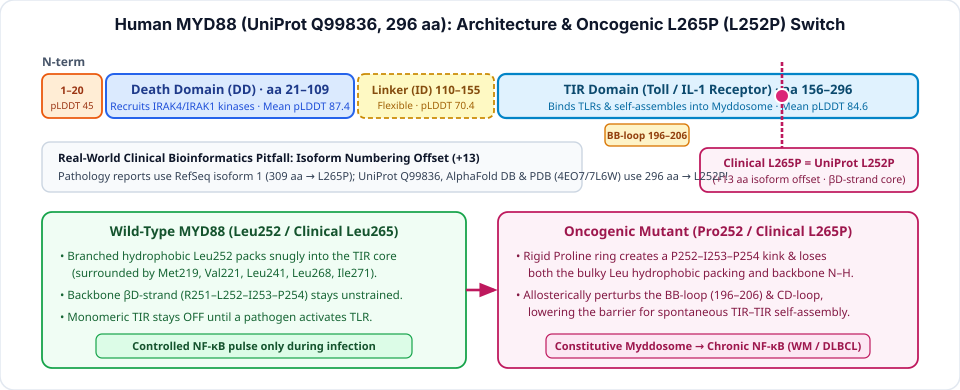
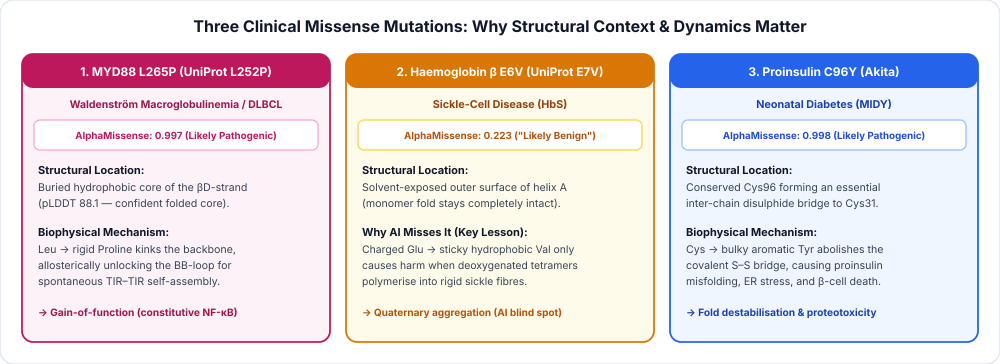

# 3.3 AlphaFold, Clinical Mutations & Molecular Dynamics

**Modelling Across Scales: From Molecules to Pandemics (Molecular Dynamics III)**
*Mitchell Lab, Brighton and Sussex Medical School*

Click **Present Slides** above to step through this lecture slide-by-slide in class (~20–25 mins), then dive into our two live Python practicals:
- [**3.4 Practical A: AlphaFold Confidence, Experimental Validation & Clinical Pathogenicity**](06-alphafold-clinical-variants.ipynb) (~25 mins)
- [**3.5 Practical B: Simulating MYD88 L265P & Clinical Mutations in OpenMM**](07-myd88-l265p-md-simulation.ipynb) (~30–35 mins)

---

## Overview: Bridging AI Structure Prediction, MD & Blood Cancer

- **In Weeks 2–3 (MD I & II):** We explored experimental `.pdb` structures and simulated a 25-residue peptide folding from scratch using **OpenMM**.
- **The clinical reality:** Most human disease proteins have **hundreds of amino acids** — far too large to fold from an unfolded chain in MD, and many have **no complete experimental crystal structure**!
- **Today's question:** *How do computational biologists combine **AlphaFold (AI)** and **Molecular Dynamics (Physics)** to understand how a single DNA base change causes human disease?*
- **Our centrepiece clinical mutation:** ***MYD88* L265P** — present in **98% of Waldenström Macroglobulinemia (WM)** patients and ~30% of ABC-DLBCL lymphomas, which you will also model at the **cellular signalling scale** next week in [**Week 4**](../signalling/01-nfkb-and-systems-biology.md)!

---

## What AlphaFold Actually Does (and Doesn't Do)

In 2020–2024, **AlphaFold 2** and **AlphaFold 3** *(Jumper et al., Nature, 2021; Abramson et al., Nature, 2024)* transformed structural biology by predicting 3D atomic coordinates directly from amino acid sequences — culminating in the **EMBL-EBI AlphaFold Protein Structure Database (AFDB)** covering >200 million proteins (including the entire human proteome).

### What AlphaFold Gives You
- Accurate **static 3D coordinates** (`.pdb` / `.cif`), often within **<1 Å** of X-ray or cryo-EM structures for well-folded domains.
- Two indispensable **uncertainty metrics** built into every prediction:
  1. **pLDDT** (*predicted Local Distance Difference Test*, `0–100`) — per-residue local confidence stored in the PDB **B-factor** column.
  2. **PAE** (*Predicted Aligned Error*, in Å) — a 2D residue-vs-residue matrix showing whether AlphaFold is confident about the **relative 3D packing between domains**.

### What AlphaFold Cannot Do Alone
- **No time, no temperature, no motion:** AlphaFold predicts a single static snapshot (not a thermodynamic ensemble!).
- **Blind to conformational switches:** Flexible functional loops (like the MYD88 **BB-loop**) can swing by **>15–20 Å** between inactive monomeric and active oligomeric states.
- **Missense mutation limitation:** Feeding a single point mutant into AlphaFold often produces a **nearly identical static backbone** — hiding dynamic destabilisation, allosteric shifts, or aggregation!

:::{admonition} Why We Combine AlphaFold + MD on Our Teaching Server
:class: note
Running AlphaFold neural-network inference from scratch requires high-end GPUs and terabytes of sequence databases — far beyond a classroom CPU server. Instead, we follow the **real-world research workflow**: pull pre-computed human structures from **AlphaFold DB** (or [AlphaFold Server](https://alphafoldserver.com/)), inspect **pLDDT/PAE** and **AlphaMissense**, introduce patient mutations *in silico*, and run **OpenMM MD** to test their physical dynamics!
:::

---

## Reading AlphaFold Confidence Like a Biochemist

Never treat an AlphaFold structure as equally reliable everywhere! Always check **both** pLDDT and PAE before running MD or interpreting a clinical mutation:

| Metric | Colour / Range | What It Means Physically | What to Expect in MD |
| :--- | :--- | :--- | :--- |
| **pLDDT > 90** | Dark blue (`#0053d6`) | Very high accuracy (even sidechains reliable) | Tightly packed folded core; **low RMSF** |
| **pLDDT 70–90** | Light blue (`#65cbf3`) | Confident backbone fold | Well-folded helices/sheets & structured loops |
| **pLDDT 50–70** | Yellow (`#ffdb13`) | Low confidence — treat coordinates cautiously | Flexible loops or linkers; **higher RMSF** |
| **pLDDT < 50** | Orange (`#ff7d45`) | Ribbon-like "spaghetti" — usually **intrinsically disordered** | Wiggles wildly in MD; **very high RMSF** |
| **Low PAE (<5 Å)** | Dark green block | Two residues are rigidly packed relative to each other | Same folded structural domain |
| **High PAE (>20 Å)** | Pale / white off-diagonal | Relative orientation between two domains is **uncertain** | Independent domains connected by a flexible hinge |

In **Practical A**, you will see this dramatically in **full-length MYD88** (`AF-Q99836-F1`): two crisp low-PAE diagonal squares (**Death Domain** and **TIR Domain**) separated by a flexible **Intermediary Linker** with high off-diagonal PAE!

---

## Centrepiece Clinical Case: *MYD88* L265P in Blood Cancer

**MYD88** (*Myeloid Differentiation Primary Response 88*, UniProt `Q99836`, 296 aa) is the master intracellular adaptor connecting **Toll-like receptors (TLRs)** to **NF-κB** activation in immune cells.

### A Famous Real-World Bioinformatics Pitfall: Isoform Numbering!
- In hospital genomics reports and haematology papers, the Waldenström Macroglobulinemia mutation is universally called ***MYD88* L265P** (numbered from the 309-aa historical RefSeq `NP_002459.2`).
- In **UniProt `Q99836-1`**, **AlphaFold DB (`AF-Q99836-F1`)**, and **RCSB PDB (`4EO7`, `7L6W`)**, canonical MYD88 is 296 aa long — so that **exact same Leucine** in the βD-strand (`R251–L252–I253–P254`) is **Leu252 (`L252P`)**, offset by **+13 residues**!
- Always verify the **surrounding amino acid motif** (`HQKRLIPIKYK`) whenever mapping a clinical variant onto a 3D structure!

---

## How Does One Amino Acid Switch Lock MYD88 "ON"?

1. **Where Leu252 sits:** Deep inside the **hydrophobic core** of the **TIR domain** (βD-strand), packed tightly (<5 Å) against **Met219** (itself mutated in DLBCL as clinical **M232T**!), **Val221**, **Leu241**, **Leu268**, and **Ile271**.
2. **What mutating Leu → Pro does chemically:**
   - **Proline** is the only amino acid whose sidechain cyclises covalently back onto its own backbone nitrogen!
   - It loses the bulky hydrophobic leucine packing, **cannot donate a backbone amide hydrogen bond**, and forces a rigid backbone angle (`φ ≈ −63°`) right next to the natural **Pro254**, creating a strained **`P252–I253–P254`** kink!
3. **Allosteric ripple to the BB-loop:**
   - That core perturbation propagates to the nearby **BB-loop (residues 196–206)** and **CD-loop (236–246)** — the exact surfaces that mediate **TIR–TIR oligomerisation** *(Clabbers et al., Nature Communications, 2021; Vyncke et al., 2016)*.
   - **Result:** Mutant MYD88 spontaneously self-assembles into an active **Myddosome** without needing a pathogen signal — driving chronic NF-κB survival signals in **98% of WM patients**!

---

## AlphaMissense & Three Clinical Mutation Archetypes

**AlphaMissense** *(Cheng et al., Science, 2023)* builds on AlphaFold's structural representations plus evolutionary conservation to score **every possible single-amino-acid missense mutation** in the human proteome from `0` (benign) to `1` (pathogenic).

Yet **no AI score is infallible!** Comparing three classic clinical mutations reveals *why* biophysical context and dynamics remain essential:

| Clinical Variant | Disease | UniProt / PDB Site | AlphaMissense Score | Biophysical Mechanism |
| :--- | :--- | :--- | :--- | :--- |
| ***MYD88* L265P** | Waldenström Macroglobulinemia / DLBCL | `Q99836` **L252P** (+13) | **`0.997` (Likely Pathogenic)** | Buried βD-strand Proline kink → allosteric BB-loop activation (gain-of-function) |
| ***HBB* E6V (HbS)** | **Sickle-Cell Disease** | `P68871` **E7V** (+1) | **`0.223` ("Likely Benign"!)** | Solvent-exposed Glu→Val patch → **quaternary polymerisation** in deoxy-Hb (AI blind spot!) |
| ***INS* C96Y (Akita)** | **Neonatal Diabetes (MIDY)** | `P01308` **C96Y** | **`0.998` (Likely Pathogenic)** | Breaks essential inter-chain **Cys31–Cys96** disulphide bond (`2.09 Å`) → misfolding & ER stress |

:::{admonition} Class Discussion Question
:class: tip
Why did DeepMind's AlphaMissense score **Sickle-Cell Disease (Haemoglobin E6V)** as **"Likely Benign" (`0.223`)**?! Look at where Glu7 sits on the 3D Haemoglobin monomer in Practical A — does it break the monomer's fold, or does pathology only emerge when *multiple* deoxygenated haemoglobin tetramers collide?
:::

---

## Preparing an AlphaFold Structure for OpenMM MD

Before running Newton's equations on an AlphaFold `.pdb` (or `.cif` from [AlphaFold Server](https://alphafoldserver.com/)), every MD pipeline follows four essential steps:

1. **Trim disordered regions (when appropriate):** Simulating full-length MYD88 (296 aa) wastes CPU on the flexible linker; excising the well-folded **TIR domain (residues 157–296, 140 aa)** keeps the functional switch intact and cuts compute time by >4×.
2. **Introduce the patient mutation *in silico*:** Keep the backbone `(N, CA, C, O)` coordinates and replace the sidechain with ideal mutant geometry (`mutate_structure(...)`).
3. **Add missing hydrogen atoms:** AlphaFold outputs **heavy atoms only** (C, N, O, S)! OpenMM's `Modeller.addHydrogens(forcefield)` adds exact pH-7.0 hydrogens matching `amber10.xml`.
4. **Energy minimise, then heat & simulate:** Relieve any initial steric clashes from mutagenesis via steepest-descent/L-BFGS minimisation, then integrate Newton's equations at **$300\text{ K}$**!

---

## Today's Practicals & SSC Assessment Ideas

### Practical A (~25 mins) — [**3.4 AlphaFold Confidence, Validation & Clinical Variants**](06-alphafold-clinical-variants.ipynb)
1. View **full-length MYD88** coloured by **AlphaFold pLDDT** and plot its **296 × 296 PAE domain map**.
2. Superpose AlphaFold MYD88 TIR onto two real experimental structures:
   - **Active higher-order assembly (`7L6W`)** → **`0.70 Å` Cα RMSD** (sub-ångström match!).
   - **Monomeric crystal (`4EO7`)** → the **BB-loop swings by `20.8 Å`**!
3. Compare real **AlphaMissense** profiles across **MYD88** (`L265P`, `M232T`, `R196C`, `S243N`), **Haemoglobin β** (`E6V` — the AI blind spot!), and **Proinsulin** (`C96Y`).

### Practical B (~30–35 mins) — [**3.5 Simulating MYD88 L265P & Clinical Mutations in OpenMM**](07-myd88-l265p-md-simulation.ipynb)
1. Inspect the **5 Å hydrophobic pocket** around **Leu252** (discovering that lymphoma hotspot **Met219 / M232T** sits right next to it!).
2. Introduce **L252P (clinical L265P)** *in silico* and run a **live OpenMM energy minimisation & MD relaxation** on the server!
3. Analyse **50 ps WT vs. L252P MYD88 TIR trajectories**:
   - Watch the animated 3D trajectory with residue 252 highlighted.
   - Test the famous hypothesis: **Does AlphaFold pLDDT predict real physical flexibility (MD RMSF)?**
   - Quantify the **Ramachandran $(\phi, \psi)$ Proline kink** at residue 252 and compare **BB-loop & βD-strand** dynamics.
4. **Bonus / Assessment Project:** Swap in **another clinical MYD88 mutation** (`M219T` = clinical `M232T`, `R196C` primary immunodeficiency, or conservative `L252I`) — or connect your atomic findings directly into **Week 4's Waldenström NF-κB ODE drug screen**!
