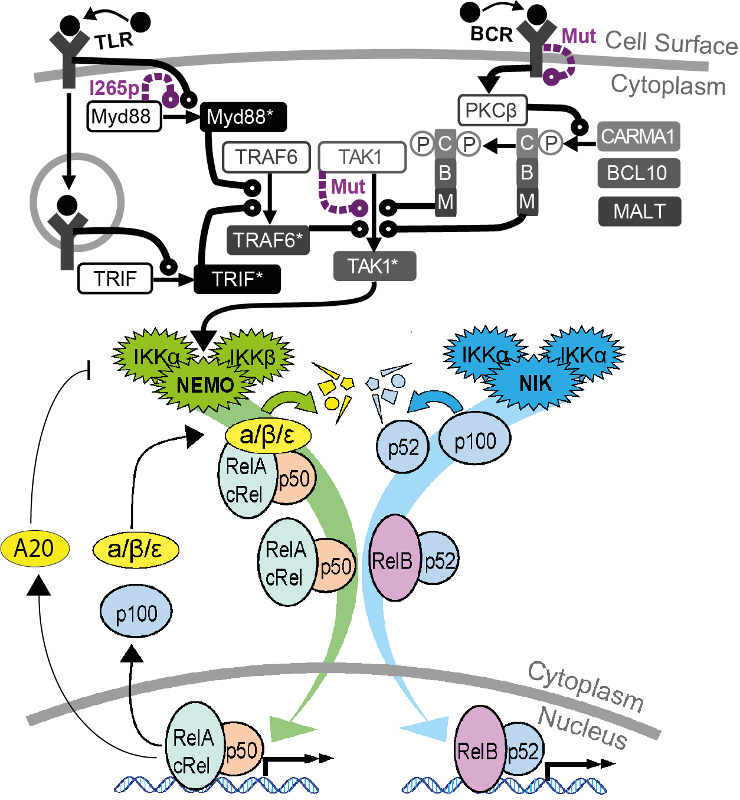
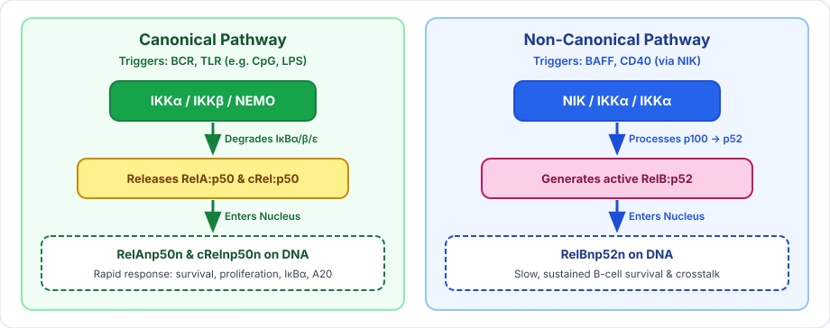
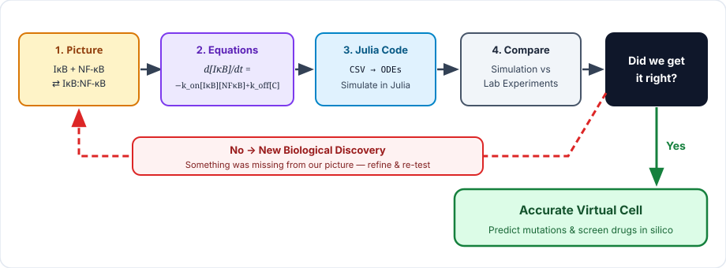
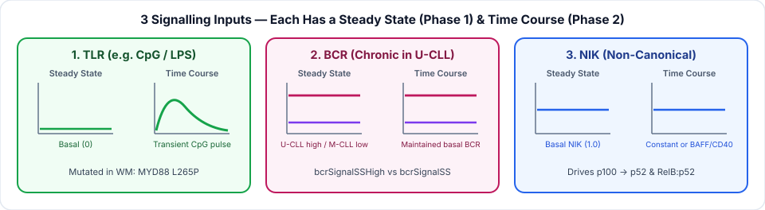

# 4.1 NF-κB Signalling in Blood Cancer & Systems Biology

**Modelling Signalling — Computational Modelling SSC (Week 4)**
*Mitchell Lab, Brighton and Sussex Medical School*

Click **Present Slides** above to step through this session slide-by-slide in class, or scroll down to read at your own pace before launching the live NF-κB simulations.

---

## Overview: Zooming Into the Cell

- **Previously:**
  - We modelled infectious disease spread across whole **populations** (SI/SIS, SIR/SIRS, Endemic SIR, SEIR).
  - You explored **molecular dynamics** at the atomic and protein scale.
- **Today:**
  - We zoom to the **cellular signalling scale**—modelling how biochemical networks inside B-cells control survival, proliferation, and drug responses in **blood cancer**!



---

## Clinical Motivation 1: Waldenström Macroglobulinemia (WM)

- A rare B-cell **lymphoma** driven by hyperactive NF-κB signalling.
- **98% of WM patients carry the *MYD88* L265P mutation**, which locks the TLR adaptor protein **MYD88** into a constitutively active (`MYD88*`) state—even without an external pathogen signal!
- **Current treatments:** BTK inhibitors (e.g. ibrutinib/zanubrutinib), proteasome inhibitors, chemotherapy, and rituximab.
- **The clinical challenge:** Survival improvements over recent decades have slowed, resistance develops, and **new targeted therapies are needed** *(Yin et al., Frontiers in Oncology, 2020)*.

:::{admonition} Look Ahead to Your Practical Challenge
:class: tip
In [**4.3 Drug Discovery for Waldenström Macroglobulinemia**](03-waldenstrom-drug-discovery.ipynb), you will switch on the **MYD88 L265P** mutation (`k1_MYD88SELFACTIVATION-TLR = 1.0`) in our virtual B-cell and screen candidate drugs to try to restore healthy signalling!
:::

---

## Clinical Motivation 2: Chronic Lymphocytic Leukaemia (CLL)

- The most common adult leukaemia in the Western world—still **incurable** with standard therapies.
- Patients fall into two major prognostic groups depending on immunoglobulin mutational status:
  - **Mutated CLL (M-CLL):** Lower basal B-cell receptor (BCR) signalling and more indolent course.
  - **Unmutated CLL (U-CLL):** **Chronic, elevated BCR signalling activity** and **significantly worse prognosis** (shorter time to treatment and reduced survival).

---

## Clinical Motivation 3: Diffuse Large B-Cell Lymphoma (DLBCL)

- The **most common aggressive blood cancer**—and **highly heterogeneous** across patients.
- Genetic subtypes (such as ABC-DLBCL / MCD) carry **recurrent mutations across the entire NF-κB network**:
  - **MYD88 L265P** (TLR pathway)
  - **BCR / CD79B** (BCR pathway)
  - **CARMA1 / CBM complex & TAK1** (upstream signalling hub)
  - **A20 (TNFAIP3) loss** (loss of negative feedback!)
- Many drugs target NF-κB signalling, yet **patients with NF-κB pathway mutations still have worse prognosis**—highlighting why we need quantitative models to predict *which* drug works for *which* mutation.

---

## Why We Need to Understand NF-κB

- **Ubiquitous transcription factor:** Expressed in almost every cell in the human body, making direct inhibition **very hard to drug safely** without severe off-target toxicity.
- **Controls critical cell fates:** Drives **cell survival** and **cell division** (bad when hijacked by lymphoma cells) and is **essential for normal immune responses**.
- **Two interconnected pathways** (*O'Donnell, Pepper, Mitchell & Pepper, Frontiers in Oncology, 2023*):



- **Very complicated!** Positive feedback, delayed negative feedback (IκBα and A20), receptor crosstalk via **shared TAK1**, and multiple NF-κB dimers (RelA:p50, cRel:p50, RelB:p52) interact simultaneously (*Mitchell, Tsui, Tan, Pack & Hoffmann, Science Signaling, 2023*).

---

## What Is Systems Biology?

How can anyone make sense of a network with more than 100 interacting proteins and reactions? **Systems biology** follows a clear, repeatable scientific loop (*Mitchell & Hoffmann, Methods in Molecular Biology, 2015*):



1. **It starts with a picture:** Draw the biochemical interaction—for example, inhibitor **IκB** binding to **NF-κB** with association rate $k_{\text{on}}$ and dissociation rate $k_{\text{off}}$:
   $$\text{I}\kappa\text{B} + \text{NF}\kappa\text{B} \underset{k_{\text{off}}}{\overset{k_{\text{on}}}{\rightleftharpoons}} \text{I}\kappa\text{B}\text{–}\text{NF}\kappa\text{B}$$
2. **We write some equations:** Translate the arrows directly into a rate-of-change equation (ODE):
   $$\frac{d[\text{I}\kappa\text{B}]}{dt} = \underbrace{-k_{\text{on}}[\text{I}\kappa\text{B}][\text{NF}\kappa\text{B}]}_{\text{Goes down as I}\kappa\text{B}\text{ binds NF}\kappa\text{B}} \;+\; \underbrace{k_{\text{off}}[\text{I}\kappa\text{B}\text{–}\text{NF}\kappa\text{B}]}_{\text{Goes up as complex dissociates}}$$
3. **We turn the equations into code:**
   ```julia
   delta(IkB) = -kon * IkBa * NFkB + koff * IkBaNFkB
   ```
   *(In our large model, `csv2model-multiscale.py` automatically generates all 140+ Julia ODEs from clean CSV reaction tables!)*
4. **We simulate the system in Julia:** Compute how nuclear NF-κB rises and falls over minutes to hours under different stimuli (e.g. TNF vs LPS).
5. **We compare simulations to lab experiments** *(Mitchell et al., Frontiers in Immunology, 2019)*.
6. **Did we get it right?**
   - **No?** Even better—**we have discovered that something was missing from our biological picture!** (e.g. *Roy, Mitchell et al., Immunity, 2019* discovered a key regulatory circuit controlling cRel dynamics in B-cell differentiation).
   - **Yes?** **We have created an accurate virtual cell** that can predict mutation effects and screen drugs *in silico*!

---

## Applying This Approach to Blood Cancer

Our B-cell NF-κB **Tri-Model** was built up modularly over nearly a decade of published systems biology research:

- *Shokhirev … Hoffmann*, **Mol. Syst. Biol.** (2015)
- *Mitchell\*, Roy\* … Hoffmann*, **PNAS** (2018)
- *Roy\*, Mitchell\* … Hoffmann*, **Immunity** (2019)
- *Cloete … Mitchell*, **npj Systems Biology and Applications** (2023)
- *Jayawant … Mitchell*, **Frontiers in Oncology** (2023)
- *Mitchell … Hoffmann*, **Science Signaling** (2023)

Instead of hand-coding hundreds of tangled equations, the model is assembled from **four clean CSV modules** (`BCR`, `TLR`, `NFkB`, and `linking`) sharing the central kinase hub **TAK1**!

---

## Three Inputs (Well, Six Really!)

Every simulation runs in **two phases**:

1. **Steady State (Phase 1 — 1,000 hours):** The virtual B-cell sits in its resting or chronic disease environment (e.g. low basal BCR in **M-CLL** vs elevated chronic BCR in **U-CLL**) until all 140 species reach equilibrium.
2. **Time Course (Phase 2 — 12 hours):** Starting from that exact steady state, we apply an acute microenvironment stimulus (such as a **TLR / CpG** pulse) and watch how nuclear NF-κB dimers respond!



:::{admonition} Our Guiding Question for the Guided Practical
:class: note
**How do different levels of basal BCR signalling (M-CLL vs U-CLL) affect how a B-cell responds to TLR activation—and can an IKK inhibitor drug reverse it?**
:::

---

## Ready for the Practical Task!

1. **First half (together):** In [**4.2 Guided Practical: Simulating CLL & Drug Responses**](02-cll-tri-model-simulation.ipynb), we will assemble the full NF-κB Tri-Model live in Julia, simulate **M-CLL**, **U-CLL**, and **U-CLL + IKK inhibitor**, and interpret the resulting nuclear NF-κB plots.
2. **Second half (your challenge):** In [**4.3 Drug Discovery for Waldenström Macroglobulinemia**](03-waldenstrom-drug-discovery.ipynb), you will turn on the **MYD88 L265P** mutation and test candidate targeted drugs to find effective therapies for Waldenström Macroglobulinemia!
