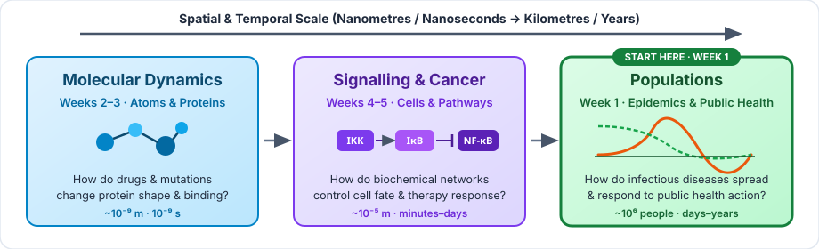

# 1.1 Introduction to Computational Modelling

**Modelling Across Scales: From Molecules to Pandemics**
*SSC Intro and Overview — Dr Simon Mitchell, Brighton and Sussex Medical School*

Use the **📽️ Present Slides** button above to step through this introduction slide-by-slide in class, or scroll straight down to read at your own pace.

---

## Thank You for Choosing This SSC!

- **Part taught, part interactive** — we explain the biology and core concepts, then immediately test them together using live computer simulations.
- **Research-led** — every modelling approach you try here is actively used in biomedical and clinical research.
- **No coding or maths knowledge required** — we will walk through every equation and line of code together in plain English so you can see *how* things work without getting bogged down in jargon.
- **Interactive in your browser** — every simulation runs live on the Mitchell Lab compute server, so you can experiment freely, break models, and reset whenever you like.

---

## Meet the Teaching Team

Our research group focuses on **computational systems biology and medicine** — trying to understand biology, disease, and treatment using computational simulations ([mitchell.science](https://mitchell.science/)).

- **Dr Simon Mitchell** — Systems biology, cancer signalling, and population/multi-scale modelling
- **Dr Eleanor Jayawant** — Computational biology & cell signalling
- **Aimilia Vareli** — Systems biology & cancer signalling

:::{admonition} Class Warm-Up
:class: note
**Introduce yourselves!**
Share your name, what drew you to this SSC, and whether you've ever seen a mathematical or computational model used in medicine (or in the news!).
:::

---

## Modelling Across Three Biological Scales

Throughout this SSC, we connect models spanning more than **15 orders of magnitude** in size and time:

1. **Molecular Dynamics (Weeks 2–3):** Simulating individual atoms and proteins to see how mutations and drugs alter protein structure and binding.
2. **Signalling & Cancer (Weeks 4–5):** Modelling biochemical networks (such as NF-κB / IκB) inside cells to predict how cancer cells respond to therapy.
3. **Populations (Week 1 — today!):** Modelling how infectious diseases spread across millions of people and how public health interventions reshape an outbreak.

---

## Why Modelling Matters in Medicine

- **Timely!** During COVID-19, compartmental epidemic differential equations appeared directly on national television (such as BBC News broadcasts) to explain lockdowns, transmission rates, and hospital capacity.
- **Key to every aspect of medicine** — from early **drug discovery** to **public health policy**.
- **The future of medicine?** **Personalised medicine** relies on patient-specific computational models to predict which therapy will work best for an individual.
- **Active research area** — rapidly expanding across cardiology, oncology, immunology, and epidemiology.
- **Quicker, cheaper—and sometimes *more accurate*—than animal models:**
  - For example, in *Scientific American* (*"Should Computer Simulations Replace Animal Testing for Heart Drugs?"*, Passini, Rodriguez & Benito, 2018), computational models of **human** heart cells showed **higher accuracy than animal models** in predicting dangerous drug-induced arrhythmias.

---

## Learning Outcomes

By the end of this SSC, you will be able to:

1. **Understand** how computers and mathematics are used to simulate biology and how that is useful for medicine.
2. **Run and modify** computational models of biological systems across multiple scales (populations, cellular signalling, and molecular dynamics).
3. **Present and critically evaluate** results generated from simulations—articulating both the insights they provide and the **limitations** of modelling.

---

## Assessment: 6-Minute Presentations

At the end of the SSC (Weeks 7–8), each student delivers a **6-minute presentation** showcasing **one modelling result** using any of the techniques covered during the course:

- **Background:** Briefly introduce the biology/clinical question and what you simulated.
- **Result & Interpretation:** Show your simulation output and explain what it means biologically or clinically.
- **Limitations & Next Steps:** Discuss what assumptions your model makes, where it might break down, and what you would add next.
- **Q&A:** Answer a question or two from the group!

:::{tip} Tip for Assessment Ideas
As we explore each model today (SI/SIS, SIR/SIRS, Endemic SIR, SEIR), pay attention to the **challenges and discussion questions** at the end of each section—many of them make excellent starting points for a 6-minute presentation!
:::

---

## Population-Scale Modelling in the Real World

When an outbreak like COVID-19 hits, epidemiologists write down a **compartmental differential equation model** tracking how many people are in each disease state over time.

For instance, the real-world Wuhan COVID-19 model shown on BBC News (Lin et al., 2020, *International Journal of Infectious Diseases*, 93: 211–216) tracks Susceptible ($S$), Exposed ($E$), Infectious ($I$), Recovered ($R$), Population ($N$), Severe/Critical ($D$), and Cumulative cases ($C$):

$$
\begin{aligned}
S' &= -\frac{\beta_0 S F}{N} - \frac{\beta(t) S I}{N} - \mu S \\
E' &= \frac{\beta_0 S F}{N} + \frac{\beta(t) S I}{N} - (\sigma + \mu) E \\
I' &= \sigma E - (\gamma + \mu) I \\
R' &= \gamma I - \mu R \\
N' &= -\mu N \\
D' &= d \gamma I - \lambda D \\
C' &= \sigma E
\end{aligned}
$$

That looks intimidating all at once! **So how do modellers actually build something like this?**

We start with the **simplest possible version** (just two boxes: **Susceptible** and **Infectious**) and add one biological feature at a time until we reach a full **SEIR** model!

Let's dive into [**1.2 The SI & SIS Model**](02-si-sis-model.ipynb) and run our first live epidemic simulation.
